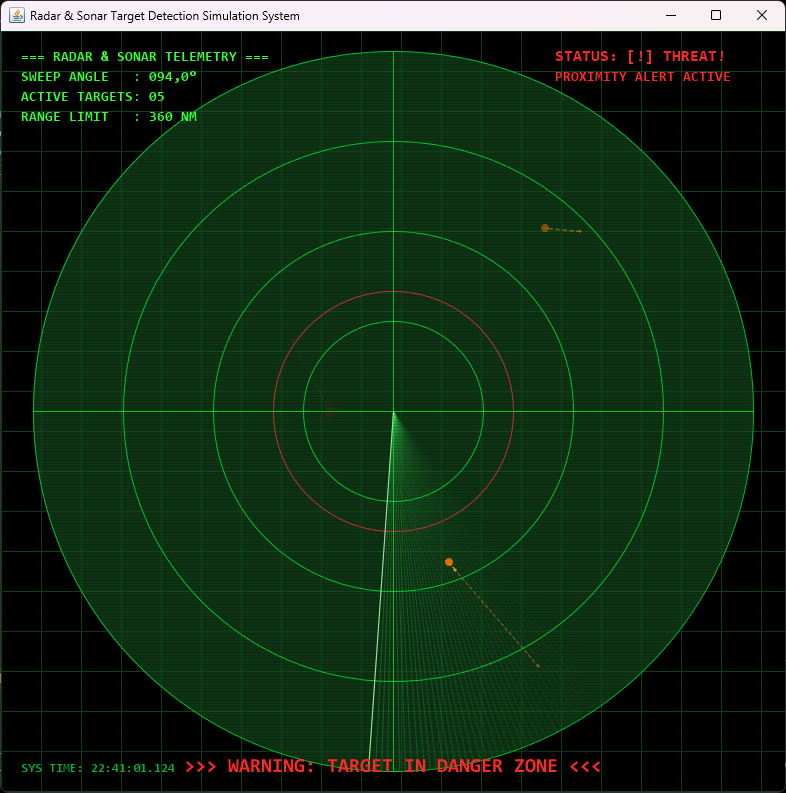

================================================================================
📡 RADAR & SONAR TARGET DETECTION SIMULATION (Java 2D)
================================================================================
Tech Stack: Java 25+ (OpenJDK) | UI: Pure Java Swing & Graphics2D | Architecture: Decoupled Engine & Service Layer

Radar & Sonar Target Detection Simulation is a lightweight, real-time 2D tracking
and early warning system designed to simulate command-and-control radar and sonar consoles.

I built this project to explore how raw sensor sweeps, coordinate transformations,
and angular collision algorithms work under the hood. No game engines (like Unity or
Godot), no external math packages, and no third-party rendering frameworks. Everything
runs entirely on pure Java Swing and Graphics2D using trigonometric projections and
low-level frame updates.

  

--------------------------------------------------------------------------------
1. HOW IT WORKS
--------------------------------------------------------------------------------
A dedicated 60 FPS Swing Timer rotates a directional beam sweep clockwise around a
dynamic center. Independent target entities drift across the sensor field with randomized
velocity vectors and dynamic heading adjustments.

Every tick, the simulation engine transforms relative Cartesian target coordinates
into polar azimuth angles via four-quadrant arctangent (atan2). When the sweep beam
intersects a target position within a 2.5-degree threshold, the target is discovered,
flashes bright orange/red, and leaves an authentic fading phosphor echo alongside a
dashed historical breadcrumb trail (past scan locations). If a target breaches the
inner perimeter (the engagement zone), the system triggers visual alarms and flushes
telemetry records into a flight recorder log file without bogging down disk I/O.

--------------------------------------------------------------------------------
2. FEATURES
--------------------------------------------------------------------------------
A) Real-Time Radar & Sonar Mechanics:
  - Dynamic Polar Coordinates: Sweep line maps dynamically to panel dimensions,
    scaling radius and origin automatically.
  - Directional Beam Sweep: Sweeps clockwise at 60 FPS (1-degree increments per 16ms tick).
  - Target Kinematics & Maneuvers: Floating bogeys drift with randomized sub-pixel speed
    vectors and subtle course adjustments (maneuver cooldowns) to mimic naval/air vessels.
  - Historical Breadcrumb Trail: Scanned target coordinates are retained up to 5 history
    points and connected via dashed trajectory vectors to display heading over time.
  - Phosphor Decay (Echo Trail): Targets flash upon sweep contact, then smoothly decay
    across 270 degrees of rotation toward transparent (alpha = 0).
  - Dynamic Inbound Spawning: Automatically purges out-of-bounds bogeys and spawns inbound
    contacts at the sensor boundary to maintain tactical density (max 6-7 targets).

B) Threat Assessment & Danger Zone:
  - Proximity Ring (Danger Zone): An inner perimeter set at 1/3 of the max range (R_danger).
  - Target Tracking Ring: Bogeys inside the critical zone receive an active red strobe ring.
  - HUD Proximity Warning: Flashing status indicator ("STATUS: [!] THREAT!") with a central
    high-priority warning banner ("WARNING: TARGET IN DANGER ZONE").
  - Safe State Handling: When clear, HUD displays steady neon green ("STATUS: SECURE [CLEAR]").

C) CRT Military Console Aesthetics:
  - Oscilloscope Grid: Dark green 40px square grid background reminiscent of analog CRT tubes.
  - Phosphor Sweep Trail: Multi-pass layered arc (45-degree sector) that renders an
    alpha-blended light tail trailing behind the active sweep line.
  - CRT Scanlines: Subtle horizontal overlay lines drawn across the screen at 3px intervals.
  - Concentric Range Rings: Four equidistant range marker rings with horizontal and
    vertical crosshairs.

D) Heads-Up Display (HUD) & Telemetry:
  - Monospace Telemetry Block: Real-time readout showing current sweep angle, active discovered
    bogey count, and naval mile (NM) range limits in Consolas font.
  - Live Threat Panel: Top-right alert module with automatic blink calculation (400ms period).
  - High-Precision System Clock: Formatted military timestamp (HH:mm:ss.SSS) updated live.

E) Thread-Safe Event Logging (Flight Recorder):
  - Black Box File I/O: Logs critical breaches into "radar_sonar_log.txt" using BufferedWriter
    with append mode and ISO timestamps.
  - State Transition Lock: Targets log on entry, then lock with a boolean flag. No repeat
    writes until the bogey exits and re-enters, eliminating disk flooding at 60 FPS.

--------------------------------------------------------------------------------
3. ARCHITECTURE OVERVIEW
--------------------------------------------------------------------------------
The codebase follows strict separation of concerns (SOLID principles):

- Main.java: Application entry point. Dispatches the UI on the Swing Event Dispatch Thread (EDT).
- MainFrame.java: JFrame host container. Configures window bounds, double buffering, and centering.
- RadarSonarPanel.java: Main view and rendering loop. Owns the 16ms Timer, draws CRT effects, HUD,
  range rings, sweep trails, breadcrumb vectors, and targets. Manages dynamic target spawning.
- Target.java: Model entity. Encapsulates position (x, y), velocity (vx, vy), turn maneuvers,
  opacity (alpha), history trail points, danger flags, and unique tracking IDs.
- RadarSonarEngine.java: Pure calculation engine. Performs Euclidean distance checks, atan2 polar
  angle calculations, circular difference thresholding, active target counting, and threat triggers.
- RadarSonarLogger.java: Thread-safe file logging service. Formats and writes telemetry alerts
  with try-with-resources.

--------------------------------------------------------------------------------
4. MATHEMATICAL & ALGORITHMIC FOUNDATION
--------------------------------------------------------------------------------
1. Polar to Cartesian Projection (Sweep Endpoint):
   Screen coordinates place (0,0) at the top-left. For center (cx, cy) and radius R:
     endX = cx + (int)(R * cos(radians(theta)))
     endY = cy + (int)(R * sin(radians(theta)))

2. Target Relative Azimuth (Four-Quadrant atan2):
   Standard arctan(dy/dx) only resolves 180 degrees and fails when dx = 0.
   We compute dx = targetX - cx and dy = targetY - cy, then resolve:
     targetAngle = toDegrees(atan2(dy, dx))
     if (targetAngle < 0) targetAngle += 360.0

3. Circular Angular Difference (Zero-Crossing Wrap):
   Comparing angles directly breaks when crossing 359 degrees to 0 degrees.
   We compute circular shortest distance:
     diff = abs(sweepAngle - targetAngle)
     if (diff > 180.0) diff = 360.0 - diff
     isDetected = (diff <= 2.5 degrees)

4. Proximity & Danger Boundary (Euclidean Distance):
     distance = sqrt(dx^2 + dy^2)
     isDanger = (distance <= maxRange / 3.0)

--------------------------------------------------------------------------------
5. TELEMETRY & LOGGING SPECIFICATION
--------------------------------------------------------------------------------
When a bogey breaches the critical perimeter, an event is logged in standard format:

[2026-10-17 22:07:12.842] [ALERT] Target ID: #3 | Coordinates: (X: 384.2, Y: 412.0) | Distance to Base: 68.4 px | STATUS: CRITICAL_PROXIMITY

Disk Flooding Mitigation:
At 60 FPS, an uncontrolled logging call inside the game loop would write 60 lines
every second per target, choking the disk. RadarSonarEngine enforces state transitions:
an alert is written once upon boundary entry. The bogey's logged flag remains true
until it physically moves outside R_danger, resetting the trigger.

--------------------------------------------------------------------------------
6. RUNNING & SETUP
--------------------------------------------------------------------------------
Requirements: Java Development Kit (JDK 17, 21 LTS, or 25+).

Option A: Quick Run (Windows Batch Script)
  Double-click `run.bat` in the project root.

Option B: Command Line (Build from Source)
  1. Compile all packages into a bin directory:
     javac -encoding UTF-8 -d bin src/com/radarsonar/*.java src/com/radarsonar/*/*.java
  2. Launch the application:
     java -cp bin com.radarsonar.Main

Option C: IntelliJ IDEA / Eclipse
  Open the project directory, verify JDK is assigned, and run Main.java directly.

--------------------------------------------------------------------------------
7. DEVELOPMENT & AUTHORSHIP NOTES
--------------------------------------------------------------------------------
This project was developed through structured pair programming. I established the
architecture, graphics loops, and object models, while consulting an AI assistant
as a senior technical sounding board for trigonometric edge cases and visual tuning.

* Written & Designed by Me:
  - System Architecture & Package Structure: Separated UI, domain models, and calculation
    engines into clean, decoupled packages (com.radarsonar.ui, model, engine).
  - Target Kinematics, Maneuvers & History Trail: Designed the Target model with auto-incrementing
    tracking IDs, heading variance, dynamic trajectory breadcrumbs, and bounded speed parameters.
  - UI Pipeline & Dynamic Spawning: Implemented the custom paintComponent pipeline in
    RadarSonarPanel, including dynamic target respawning, boundary pruning, CRT scanlines, and HUD.
  - Event Handling & Swing Threading: Configured the 16ms javax.swing.Timer loop on the Swing
    EDT to ensure thread safety without lock contention.
  - Anti-Spam File I/O: Identified the potential disk bottleneck of 60 FPS writes. Designed
    the target state transition flag (logged boolean) to make logging discrete and safe.

* AI-Assisted (Pair Programming):
  - Trigonometric Edge Cases: Formulated the circular difference equation to handle the
    359-to-0 degree wrap-around seam in sweep detection.
  - Canvas Coordinate Inversion: Adjusted angle conventions to account for Java2D's inverted
    y-axis (positive Y heading downward).
  - Shader & CRT Visual Math: Iterated on alpha gradient values for the 45-step layered
    beam trail and spacing calculations for the scanline pass.
  - Documentation & Clean Code Review: Reviewed method contracts, documentation comments,
    and verified strict separation of math from rendering.
================================================================================